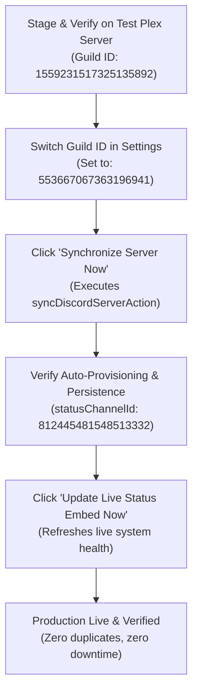

# 🌐 DomsHomeLab Production Discord Server Architecture & Migration Blueprint

> **Environment**: Live Production Discord Server  
> **Server Name**: `Plex Group`  
> **Guild ID**: `553667067363196941`  
> **Portalarr Target Version**: `v1.1.0`  
> **Total Members**: 20 Active Users & Household Members  
> **Test Staging Counterpart**: `Test Plex Server` (`1559231517325135892`)

---

## 1. Executive Summary & Production Posture

The **Plex Group** server is the real, customer-facing Discord community for DomsHomeLab. It hosts 20 active streamers, media requestors, and household accounts.

Because active users rely on this server for real-time Plex alerts, media requests, and support tickets, changes should **never** be applied directly to production without prior validation on the **Test Plex Server**.

This document maps out every category, live channel, legacy archive channel, role hierarchy, and provides a **zero-downtime, safe promotion workflow** to migrate approved website and bot features into production.

---

## 2. Production Role Hierarchy & Provisioning Matrix

Roles currently configured on the live server:

| Position | Role Name | Role ID | Color | Permissions | Purpose & Scope |
| :---: | :--- | :--- | :---: | :---: | :--- |
| **11** | `Admin` | `1377295566781943960` | Blue (`#3498DB`) | Administrator | Legacy server owner & administrator role |
| **10** | `sesh` | `1440350351160119349` | Default (`#000000`) | Bot Integration | Calendar / scheduled event management bot |
| **9** | `Notifiarr` | `1440350544647684210` | Default (`#000000`) | Bot Integration | Legacy webhook notification relay |
| **8** | `Gemini_CLI_Connector` | `1558171293436612692` | Default (`#000000`) | Administrator (`0x8`) | **Primary DomsHomeLab Bot Application** |
| **7** | `👑 Admin` | `1558276499084288021` | Amber (`#F59E0B`) | Elevated Member | Standardized Portalarr Platform Admin role |
| **6** | `🛡️ Moderator` | `1558276500355022958` | Cyan (`#06B6D4`) | Moderation | Community ticket helpers & moderators |
| **5** | `⭐ Member` | `1558228646525665412` | Emerald (`#10B981`) | Standard Member | Active approved Plex streamers & household accounts |
| **4** | `⏱️ Trial Pass` | `1558228646911672363` | Blue (`#3B82F6`) | Isolated Read | 48-Hour evaluation trial accounts |
| **3** | `🧒 Kids Account` | `1558228647976898733` | Pink (`#EC4899`) | Child Profile | Managed household child profile (safe content only) |
| **2** | `📺 Living Room Device`| `1558228648677482568` | Violet (`#6366F1`) | Device Profile | Shared household Apple TV / Nvidia Shield profile |
| **1** | `⏳ Pending Approval` | `1558228649541374154` | Gray (`#9CA3AF`) | Read Only | New arrivals awaiting onboarding approval |
| **0** | `@everyone` | `553667067363196941` | Default (`#000000`) | Restricted View | Default unverified role. Can only see `#welcome-and-rules` |

---

## 3. Comprehensive Live Channel Map (All 52 Channels)

The production server contains active blueprint channels alongside legacy channels accumulated from prior setups.

### 📌 Category 1: WELCOME & INFO (`1343807831614160926`)

| Channel Name | Channel ID | Status | Purpose & Topic |
| :--- | :---: | :---: | :--- |
| `#welcome-and-rules` | `1336766499200958525` | Active | Onboarding rules, etiquette, and profile linking guide |
| `#announcements` | `1343809337985863710` | Active | Official platform announcements, maintenance notices |
| `#links-and-webhooks` | `1343814266263830618` | Active | Direct links to Web Portal, Overseerr, Tautulli, guides |
| `#roadmap-and-updates`| `1353117750758998016` | Active | Hardware roadmap, NVMe upgrades, 4K transcode nodes |
| `#maintenance` | `1363921408215875604` | Active | Scheduled maintenance windows (Daily 5:00 AM – 5:30 AM) |
| `#plex-invites` | `1369683308631560202` | Active | Direct instructions for accepting Plex server invitations |
| `#membership-info` | `1558239464164294839` | Active | Household features, zero-pricing policy, request rules |

### 📖 Category 2: GUIDES & SELF-SERVICE (`1343807480479617046`)

| Channel Name | Channel ID | Status | Purpose & Topic |
| :--- | :---: | :---: | :--- |
| `#plex-setup-guides` | `1558230275027247134` | Active | Direct Play guide for Apple TV, Roku, Shield, Fire TV, LG/Samsung |
| `#transcode-doctor` | `1558230275950125261` | Active | Buffering self-service, subtitle fixes, 30-second fix |
| `#kindle-and-audiobooks` | `1558239468354273280` | Active | Send-to-Kindle configuration, approved senders, reader setup |

### 💬 Category 3: COMMUNITY CHAT (`1343806593786970124`)

| Channel Name | Channel ID | Status | Purpose & Topic |
| :--- | :---: | :---: | :--- |
| `#general-chat` | `1343808192102269000` | Active | Main community conversation, homelab banter |
| `#polls-and-feedback` | `1440019243771887707` | Active | Community voting on upcoming library additions |
| `#book-nook` | `1558230280563720282` | Active | Book club discussions, author suggestions, Kindle chat |
| `#movie-and-tv-talk` | `1558239470308958308` | Active | Spoiler-free movie and television chat, watch parties |

### 🎬 Category 4: REQUESTS & MEDIA (`1343807419523792926`)

| Channel Name | Channel ID | Status | Purpose & Topic |
| :--- | :---: | :---: | :--- |
| `#media-requests` | `1343809489375330314` | Active | Automated Seerr request updates and approval alerts |
| `#recently-added` | `1558230283470508032` | Active | Automated feed of newly ingested 4K & HD titles |
| `#leaving-soon` | `1558230284560769085` | Active | Maintainerr pruning radar (14-day watch grace period) |

### 🆘 Category 5: HELP & TICKETS (`1343806730957754381`)

| Channel Name | Channel ID | Status | Purpose & Topic |
| :--- | :---: | :---: | :--- |
| `#server-uptime` | `812445481548513332` | Active | **Primary Production Live Cockpit**: Vitals & outage alerts |
| `#support-tickets` | `1558230286016319649` | Active | Open support tickets & bug reports with administrators |
| `#main-server-request-issues` | `1343805546750283840` | Legacy Forum | Old forum channel for request issues (Type 15) |
| `#kid-server-request-issues` | `1343808506502975541` | Legacy Forum | Old forum channel for kids server issues (Type 15) |

### 🤖 Category 6: BOT & AUTOMATION (`1343807553758560336`)

| Channel Name | Channel ID | Status | Purpose & Topic |
| :--- | :---: | :---: | :--- |
| `#main-server-feed` | `1343809561580273674` | Active | Radarr/Sonarr grab & import alerts for Main Plex |
| `#deletion-audit` | `1343809611513466880` | Active | Maintainerr deletion logs and disk space reclaimed |
| `#kid-server-requests` | `1343809650264510534` | Legacy | Older dedicated kids request feed |
| `#kid-server-feed` | `1343809715507036291` | Active | Radarr/Sonarr grab & import alerts for Kids Plex |
| `#kid-server-deleted-files` | `1343809754463469610` | Legacy | Older deletion log channel for kids server |
| `#kid-server-health-updates` | `1343810566556221496` | Legacy | Older health update channel |
| `#host-health-glances`| `1343810641504501781` | Active | Real-time hardware alerts (CPU, RAM, ZFS storage) |
| `#backup-server-health-updates`| `1343813048594600027` | Legacy | Backup server monitoring feed |
| `#files-to-be-deleted` | `1420767332979970149` | Legacy | Manual deletion staging list |
| `#bot-commands` | `1558230296946806790` | Active | Bot diagnostic commands and manual sync triggers |
| `#portalarr-logs` | `1558230299488297071` | Active | Automated sync logs and audit dispatch telemetry |

### 🔒 Category 7: STAFF & ARCHIVE (`1353570261063962635`)
*All legacy channels preserved for historical audit without cluttering member view.*

| Channel Name | Channel ID | Status | Notes |
| :--- | :---: | :---: | :--- |
| `#staff-lounge` | `1336766499200958528` | Active | Admin & operator discussion lounge |
| `#legacy-general` | `553667067996405772` | Archived | Original server general channel (March 2019) |
| `#legacy-up-down-trackers` | `1343807663196340234` | Archived | Old uptime robot webhooks |
| `#legacy-issues` | `1343815962956398662` | Archived | Historical member issue threads |
| `#updates-and-maintenance` | `728302259892649995` | Archived | Historical manual maintenance posts |
| `#movies-and-shows-to-be-deleted`| `728258716935127091` | Archived | Pre-Maintainerr manual deletion warnings |
| `#main-overserr-requests` | `611998247728447528` | Archived | Historical Overseerr webhooks |
| `#issues` | `1336767851620470814` | Archived | Historical issues log |
| `#kids-overserr-requests` | `1336766935316299879` | Archived | Historical kids overseerr webhooks |
| `#missing-episodes-or-movies`| `655177868837519380` | Archived | Old missing content tracker |
| `#links` | `1319391872900272209` | Archived | Pre-blueprint links channel |
| `#general-issues` | `1343814177759952946` | Archived | Historical issue tracker |

### ⚠️ Empty Duplicate Category
- `🔒 7. STAFF & VAULT` (`1558276524569010432`): An empty duplicate category created during previous template tests. Can be safely deleted in Discord directly.

---

## 4. Side-by-Side Comparison: Live Server vs. Test Server

| Component | Test Server (`1559231517325135892`) | Live Server (`553667067363196941`) | Parity Status & Action |
| :--- | :--- | :--- | :--- |
| **Member Count** | 2 (Staging Only) | 20 (Production Users) | Expected |
| **Status Channel** | `#server-uptime` (`1559236291894182042`) | `#server-uptime` (`812445481548513332`) | **Exact Match**: Reuses existing channel without recreation |
| **Requests Channel**| `#media-requests` (`1559236277889671218`) | `#media-requests` (`1343809489375330314`) | **Exact Match**: Seamless webhook integration |
| **Announcements** | `#general` (Temporary) | `#announcements` (`1343809337985863710`) | Live has production announcements channel |
| **Support Tickets** | `#support-tickets` (`1559236286638981140`) | `#support-tickets` (`1558230286016319649`) | **Exact Match**: Same blueprint topic & pinned guide |
| **AI Assistant Links**| Staged in `#transcode-doctor` | Pending rollout | Ready to push from Test to Live |
| **"Suggest a Fix"** | Staged in `#support-tickets` | Pending rollout | Ready to push from Test to Live |
| **My Plex Hub Speedtest**| Staged in `#plex-setup-guides` | Pending rollout | Ready to push from Test to Live |
| **Kindle Wi-Fi Sync** | Staged in `#kindle-and-audiobooks`| Pending rollout | Ready to push from Test to Live |
| **Legacy Clutter** | 2 default channels | 12 archived legacy channels | Live maintains historical audit archive |

---

## 5. Safe Promotion Workflow (Test ➔ Live)

Follow this verified 6-step procedure to safely promote updates from the **Test Plex Server** into the **Live Plex Group Server**:



### Step 1: Pre-Promotion Sanity Check on Test Server
1. Confirm all test embeds render without markdown syntax errors on `Test Plex Server`.
2. Confirm the 24/7 AI Assistant, "Suggest a Fix", and My Plex Hub links point to your production URL (`https://domshomelab.org`).

### Step 2: Switch the Target Guild ID
1. Navigate to **DomsHomeLab Mission Control → Settings → Discord Bot**.
2. Update **Discord Server (Guild) ID** to:
   ```
   553667067363196941
   ```
3. Click **Save Settings**.
4. Click **Test Connection** to confirm the bot connects as `Gemini_CLI_Connector` to `Plex Group • 20 members`.

### Step 3: Run Server Synchronization
1. Click **Synchronize Server Now**.
2. The synchronization engine performs an intelligent in-place update:
   - Existing channels (such as `#server-uptime`, `#media-requests`, `#support-tickets`) are **matched by name** and updated in place. **No duplicate channels are created**.
   - Channel topics and permission overwrites are aligned with canonical security policies.
   - Pinned guide embeds in `#welcome-and-rules`, `#plex-setup-guides`, and `#kindle-and-audiobooks` are updated to match latest copy.
   - The engine automatically resolves and persists:
     - `discordStatusChannelId`: `812445481548513332`
     - `discordRequestsChannelId`: `1343809489375330314`
     - `discordAnnouncementsChannelId`: `1343809337985863710`

### Step 4: Refresh Live System Status Cockpit
1. Click **Update Live Status Embed Now**.
2. Open `#server-uptime` in Discord:
   - Verify the pinned embed displays **"DomsHomeLab Infrastructure Cockpit"**.
   - Verify green latency telemetry, active stream counters, and service links.

### Step 5: Post-Promotion Rollback Procedure
If any configuration needs to be rolled back or tested further:
1. Re-enter the Test Guild ID: `1559231517325135892`.
2. Click **Save Settings**.
3. All background automation (such as outage alerts) immediately retargets the staging server.
