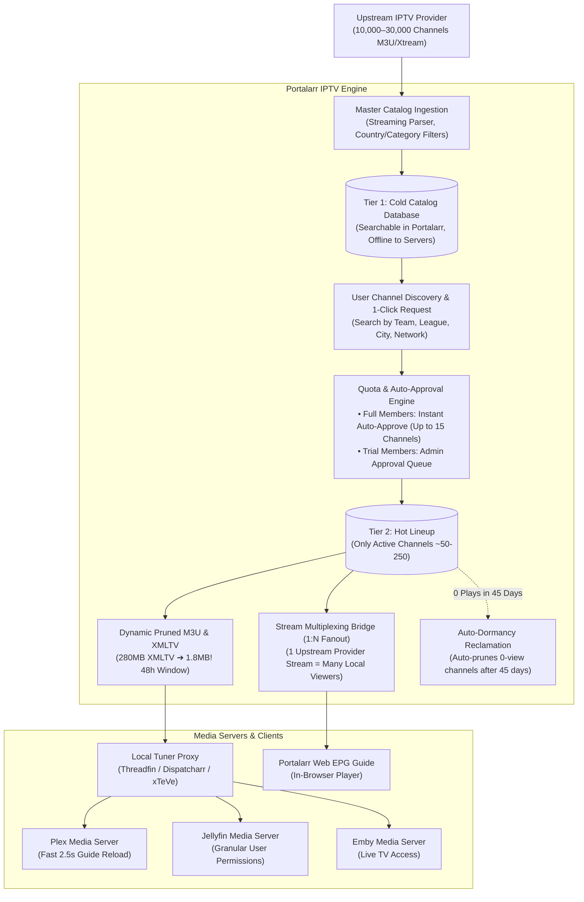

# 📺 Portalarr IPTV Hub: On-Demand Channel Requests & Auto-Provisioning Engine
**Architectural Specification & System Design**  
*Target Release Milestone: v1.4.0+ | Author: Deep Architect (Layer 1) & Antigravity*

---

## 1. Executive Summary & Problem Statement

### The Fundamental Problem
Upstream IPTV providers furnish massive raw playlists (5,000 to 30,000+ channels) coupled with gargantuan XMLTV guide files (100MB–600MB). Ingesting these master feeds directly into Plex, Jellyfin, Emby, or Threadfin creates disastrous operational bottlenecks:
- **Plex PMS SQLite Lockups**: Plex's internal database (`com.plexapp.plugins.library.db`) locks up when processing >400–500 live channels, leading to guide sync timeouts, crash loops, and degraded playback across VOD libraries.
- **Client App Guide Lag**: Apple TV, Roku, Android TV, and Fire TV clients freeze or crash attempting to render a 15,000-channel EPG grid.
- **Provider Account Bans**: IPTV providers enforce strict concurrent stream limits (typically 2 to 5 connections). When multiple household members or server users watch popular live events (e.g., Super Bowl, UFC PPV), unmanaged direct streams exhaust account slots and trigger instant provider IP/account bans.
- **Admin Burnout**: Administrators cannot feasibly curate 2,000+ channels manually or predict which niche sports team, regional broadcast, or international event users want to watch.

### The Architectural Solution: Dual-Tier On-Demand Provisioning
Portalarr decouples the **Master Upstream Catalog (Cold Tier)** from the **Active Tuner Lineup (Hot Tier)**:



---

## 2. Database Schema (`prisma/schema.prisma`)

```prisma
// ============================================================================
// --- IPTV HUB & ON-DEMAND PROVISIONING MODELS ---
// ============================================================================

model IptvProvider {
  id                    String              @id @default(cuid())
  name                  String              // Friendly provider label e.g. "Primary IPTV - StrongStreams"
  type                  String              @default("XTREAM") // "XTREAM", "M3U_URL", "LOCAL_M3U"
  serverUrl             String              // e.g. "http://line.provider.tv:8080"
  username              String?             // Encrypted or plain upstream username
  password              String?             // AES-256-GCM encrypted upstream password
  m3uUrl                String?             // For direct M3U providers
  epgUrl                String?             // Master upstream XMLTV URL
  maxConcurrentStreams  Int                 @default(2) // Purchased provider stream capacity
  activeStreamCount     Int                 @default(0) // Live downstream connections actively consuming upstream
  streamOutputFormat    String              @default("ts") // "ts", "m3u8", "auto"
  countryFilter         String?             // JSON array e.g. ["US", "CA", "UK"] - discards foreign bloat at parse time
  categoryFilter        String?             // JSON array of category whitelist/blacklist
  syncIntervalHours     Int                 @default(24) // Catalog refresh schedule
  lastSyncAt            DateTime?
  lastSyncStatus        String?             // JSON summary: { total: 18500, ingested: 3200, skipped: 15300, durationMs: 4120 }
  status                String              @default("ACTIVE") // "ACTIVE", "ERROR", "DISABLED", "RATE_LIMITED"
  errorMessage          String?
  isEnabled             Boolean             @default(true)
  priority              Int                 @default(1) // 1 = Primary, 2 = Secondary/Fallback
  customHeaders         String?             // JSON key-value headers e.g. {"User-Agent": "VLC/3.0.18"}
  createdAt             DateTime            @default(now())
  updatedAt             DateTime            @updatedAt

  channels              IptvChannel[]
  activeStreams         IptvActiveStream[]

  @@index([isEnabled, priority])
}

model IptvChannel {
  id                    String              @id @default(cuid())
  providerId            String
  provider              IptvProvider        @relation(fields: [providerId], references: [id], onDelete: Cascade)
  upstreamStreamId      String              // Upstream stream ID or M3U stream URL hash
  upstreamUrl           String              // AES-256-GCM encrypted raw streaming URL
  name                  String              // Raw provider name: "US | ESPN HD [60FPS]"
  cleanName             String              // Normalized display name: "ESPN"
  callSign              String?             // e.g. "ESPN-HD"
  logoUrl               String?             // Channel icon / tvg-logo
  groupTitle            String?             // Raw category e.g. "USA SPORTS"
  category              String?             @default("SPORTS") // Normalized: "SPORTS", "NEWS", "ENTERTAINMENT", "MOVIES", "KIDS", "LOCALS", "OTHER"
  country               String?             @default("US") // e.g. "US", "CA", "UK"
  language              String?             @default("en")
  resolution            String?             // "4K", "1080p", "720p", "SD"
  frameRate             Float?              // 60.0, 30.0, 29.97
  tvgId                 String?             // EPG mapping ID e.g. "ESPN.us"
  tvgName               String?             // EPG title e.g. "ESPN HD"
  tvgShift              String?             // EPG timezone shift
  tags                  String?             // JSON array of searchable tokens e.g. ["NFL", "NBA", "MLB", "Sports"]

  // Provisioning & Lineup Attributes
  isProvisioned         Boolean             @default(false) // Hot vs Cold catalog gate
  provisionedAt         DateTime?
  channelNumber         Int?                @unique // Virtual guide number e.g. 1042 (Plex/Threadfin)
  isPinned              Boolean             @default(false) // Immune to auto-prune (e.g. core locals, admin channels)
  pinReason             String?             // "Core Local", "Admin Permanent"
  
  // Usage Telemetry & Inactive Channel Pruning
  viewCount             Int                 @default(0)
  totalWatchDurationSec Int                 @default(0)
  lastViewedAt          DateTime?
  lastViewerUserId      String?
  lastPruneWarningAt    DateTime?           // Timestamp when impending deletion warning was dispatched
  status                String              @default("ONLINE") // "ONLINE", "OFFLINE", "UNSTABLE"
  lastHealthCheckAt     DateTime?

  createdAt             DateTime            @default(now())
  updatedAt             DateTime            @updatedAt

  requests              IptvChannelRequest[]
  activeStreams         IptvActiveStream[]

  @@index([providerId])
  @@index([isProvisioned])
  @@index([category])
  @@index([country])
  @@index([cleanName])
  @@index([lastViewedAt])
  @@index([upstreamStreamId, providerId])
}

model IptvChannelRequest {
  id                    String              @id @default(cuid())
  channelId             String
  channel               IptvChannel         @relation(fields: [channelId], references: [id], onDelete: Cascade)
  userId                String
  user                  User                @relation(fields: [userId], references: [id], onDelete: Cascade)
  status                String              @default("PENDING") // "PENDING", "APPROVED", "PROVISIONED", "REJECTED", "PRUNED"
  autoApproved          Boolean             @default(false)
  approvalReason        String?             // e.g. "Auto-approved: Full Member Quota Valid"
  adminNotes            String?
  userReason            String?             // User justification e.g. "College football tournament"
  requestedAt           DateTime            @default(now())
  approvedAt            DateTime?
  provisionedAt         DateTime?
  lastViewedByUserAt    DateTime?
  userViewCount         Int                 @default(0)
  expiryDate            DateTime?           // Optional temporary lease (e.g., weekend sports pass)
  createdAt             DateTime            @default(now())
  updatedAt             DateTime            @updatedAt

  @@index([userId, status])
  @@index([channelId])
  @@index([status])
  @@index([createdAt])
}

model IptvTunerProxy {
  id                    String              @id @default(cuid())
  name                  String              // e.g. "Local Threadfin Container"
  type                  String              @default("THREADFIN") // "THREADFIN", "DISPATCHARR", "XTEVE", "PORTALARR_NATIVE"
  url                   String              // e.g. "http://192.168.1.50:34400"
  apiKey                String?             // Encrypted API token/password
  tunerCount            Int                 @default(4) // Virtual HDHomeRun tuners exposed downstream
  virtualM3uUrl         String?             // Exported M3U feed URL
  virtualXmltvUrl       String?             // Exported XMLTV feed URL
  isDefault             Boolean             @default(true)
  isActive              Boolean             @default(true)
  lastSyncAt            DateTime?
  lastSyncStatus        String?             // Telemetry summary of last reload
  syncOnApproval        Boolean             @default(true) // Auto-reload tuner proxy upon channel provisioning
  targetMediaServers    String?             // JSON array of MediaServer/PlexServer IDs to trigger on reload
  createdAt             DateTime            @default(now())
  updatedAt             DateTime            @updatedAt
}

model IptvActiveStream {
  id                    String              @id @default(cuid())
  channelId             String
  channel               IptvChannel         @relation(fields: [channelId], references: [id], onDelete: Cascade)
  providerId            String
  provider              IptvProvider        @relation(fields: [providerId], references: [id], onDelete: Cascade)
  userId                String?
  user                  User?               @relation(fields: [userId], references: [id], onDelete: SetNull)
  mediaServerType       String              @default("PLEX") // "PLEX", "JELLYFIN", "EMBY", "DIRECT"
  clientIp              String
  clientDevice          String?             // e.g. "Apple TV 4K", "Living Room Shield"
  clientUserAgent       String?
  startedAt             DateTime            @default(now())
  lastKeepAliveAt       DateTime            @default(now())
  bytesTransferred      Float               @default(0)
  isMulticastLeader     Boolean             @default(false) // True if holding physical upstream connection
  upstreamSessionId     String?             // Multiplex cluster identifier
  status                String              @default("STREAMING") // "STREAMING", "TERMINATED", "TIMED_OUT"
  stoppedAt             DateTime?
  durationSeconds       Int                 @default(0)

  @@index([channelId, status])
  @@index([providerId, status])
  @@index([userId])
  @@index([startedAt])
}
```

---

## 3. Self-Service Channel Request & Auto-Provisioning Pipeline

1. **Member Searches Catalog (`/discover/tv` or in Live TV modal)**:
   - Search by team (e.g. "Lions", "Warriors"), league ("NFL", "F1", "EPL"), network ("Bally", "Sky", "ESPN"), or city.
   - Portalarr queries the cold `IptvChannel` index in `<15ms`.
2. **1-Click "Add to Lineup"**:
   - **Full Members:** Auto-approved immediately if within personal quota (e.g., up to 15 custom channels).
   - **Trial Members:** Placed in the Admin Approval queue.
3. **Automated Provisioning Dispatch**:
   - Assigns a virtual channel number (Sports: 1000s, News: 1200s, Locals: 1300s, Movies: 1400s).
   - Marks `IptvChannel.isProvisioned = true`.
   - Regenerates the virtual M3U and dynamic 48h XMLTV guide.
   - Pushes reload commands to the Tuner Proxy (Threadfin / Dispatcharr) and media servers (Plex, Jellyfin, Emby).
   - Channel appears on user TVs in seconds.

---

## 4. Inactive Channel Reclamation Engine (Auto-Pruner)

To prevent the lineup from creeping back to 800+ channels over months:
- **Weekly Evaluation (`0 4 * * 0` Sunday 4 AM)**:
  - Scans all unpinned provisioned channels (`isProvisioned = true AND isPinned = false`).
  - Calculates `daysInactive = NOW - max(lastViewedAt, provisionedAt)`.
  - **At 38 Days of 0 Plays**: Dispatches friendly warning to the original requester:
    > *"Channel 'Sky Sports F1' has had 0 views for 38 days. It will be released in 7 days to free up tuner slots."*
    *(If anyone tunes into the channel, `lastViewedAt` resets the 45-day clock!).*
  - **At 45 Days of 0 Plays**: Channel is automatically unprovisioned, channel number freed, and proxy reloaded.
  - Core network channels (ABC, CBS, NBC, FOX, ESPN) are marked `isPinned = true` and are 100% immune to pruning.

---

## 5. Stream Deduplication & Provider Ban Protection (1:N Fanout)

Upstream IPTV providers enforce hard concurrent stream limits (2 to 5 connections). If 4 household members tune into the Super Bowl or a Sunday NFL game simultaneously:
- **Raw IPTV**: Opens 4 upstream connections ➔ Provider account banned or throttled.
- **Portalarr Stream Bridge (`GET /api/iptv/stream/[channelId]`)**:
  - If Channel 1024 is already playing, User B and User C attach to the existing local broadcast stream.
  - **Only 1 upstream provider connection is consumed.**
  - If provider stream cap is reached by different channels, subsequent channel requests receive a friendly *"All provider tuner slots currently in use"* notice rather than risking account termination.

---

## 6. Implementation Phases

- **Phase 1: Database & Provider Manager**
  - Add Prisma models and migration.
  - Create Admin IPTV Provider settings panel (M3U / Xtream connection test, country filter, stream limit).
- **Phase 2: Master Ingestion & Dynamic Pruned Guide Engine**
  - Chunked streaming M3U parser.
  - Dynamic virtual `/api/iptv/lineup.m3u` and lightweight 48-hour `/api/iptv/lineup.xml` generator.
- **Phase 3: Channel Discovery & Auto-Provisioning**
  - User-facing Channel Discovery UI with category filters, search, and "Add to Lineup" button.
  - Server actions for requesting, auto-approving, and releasing channels.
- **Phase 4: Stream Multiplexer & Inactive Reclamation Cron**
  - 1:N fanout stream bridge for stream deduplication.
  - Automated 45-day dormancy pruner.
