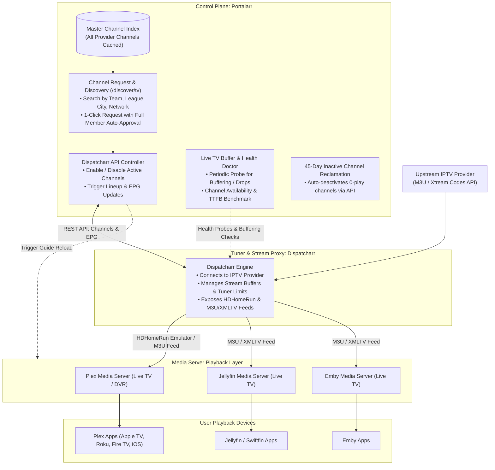

# 📺 Portalarr IPTV Hub: Dispatcharr Integration & Live TV Channel Management
**Architectural Specification & System Design**  
*Target Release Milestone: v1.4.0+ | Author: Antigravity & Deep Architect*

---

## 1. Executive Summary & Topology

### Separation of Concerns
In this architecture, **Portalarr does NOT serve live video streams directly to end users**. Instead, playback and stream delivery are cleanly delegated to the homelab media stack:



### Key Benefits
1. **Zero Media Server Guide Bloat**: Instead of pushing all 10,000+ upstream channels into Plex/Jellyfin (which causes Plex database lockups and client app freezing), Dispatcharr exposes only an active, curated lineup (~50 to 200 channels).
2. **Native TV Experience**: Users continue watching on their preferred TV apps (Plex, Swiftfin/Jellyfin, or Emby) with full DVR and native hardware-accelerated playback.
3. **Portalarr as the Intelligent Orchestrator**: Portalarr manages user requests, commands Dispatcharr via REST API, triggers media server guide refreshes, and runs buffer diagnostics.

---

## 2. Dispatcharr Integration & API Bridge

Portalarr connects to Dispatcharr's REST API using its base URL and API key:

### 2.1 Core API Interactions
- **Master Channel Ingestion & Search (`GET /api/channels`)**:
  Portalarr periodically queries Dispatcharr to synchronize the master channel catalog into SQLite. Channels remain disabled in Dispatcharr until activated.
- **On-Demand Channel Activation (`POST /api/channels/{id}/enable`)**:
  When a user requests a channel:
  1. Portalarr validates user quotas (e.g. up to 10–15 channels per Full Member).
  2. Portalarr calls Dispatcharr's API to enable the channel in the active lineup.
  3. Portalarr triggers Dispatcharr's EPG sync (`POST /api/epg/sync`).
- **Channel Deactivation & Reclamation (`POST /api/channels/{id}/disable`)**:
  When a channel has 0 views for 45 days, Portalarr calls Dispatcharr to disable it, immediately freeing the channel slot.
- **Media Server Guide Triggering**:
  Immediately after Dispatcharr updates its lineup, Portalarr notifies the configured media servers to reload their guides:
  - **Plex**: `POST {plexUrl}/livetv/dvrs/{id}/reloadGuide?X-Plex-Token={token}`
  - **Jellyfin**: `POST {jellyfinUrl}/LiveTv/Tuners/Discover` and `POST {jellyfinUrl}/ScheduledTasks/Running/{guideTaskId}`
  - **Emby**: `POST {embyUrl}/LiveTv/Tuners/Discover?api_key={key}`

---

## 3. Database Schema (`prisma/schema.prisma`)

```prisma
// ============================================================================
// --- DISPATCHARR & IPTV HUB MODELS ---
// ============================================================================

model DispatcharrConfig {
  id                    String              @id @default("global")
  name                  String              @default("Dispatcharr Tuner Proxy")
  url                   String              // e.g. "http://192.168.1.50:9000"
  apiKey                String              // AES-256-GCM encrypted API key
  maxConcurrentStreams  Int                 @default(3) // Upstream provider stream limit
  isActive              Boolean             @default(true)
  lastSyncAt            DateTime?
  lastSyncStatus        String?             // JSON summary of catalog sync
  autoReloadMediaServers Boolean            @default(true) // Trigger Plex/Jellyfin guide reload on change
  createdAt             DateTime            @default(now())
  updatedAt             DateTime            @updatedAt
}

model IptvChannel {
  id                    String              @id @default(cuid())
  dispatcharrChannelId  String              @unique // Dispatcharr internal channel ID
  name                  String              // Raw provider title: "US | ESPN HD [60FPS]"
  cleanName             String              // Normalized title: "ESPN"
  callSign              String?             // e.g. "ESPN-HD"
  logoUrl               String?             // Channel icon
  groupTitle            String?             // Category: "USA SPORTS"
  category              String?             @default("SPORTS") // "SPORTS", "NEWS", "ENTERTAINMENT", "LOCALS", "OTHER"
  country               String?             @default("US")
  resolution            String?             // "1080p", "720p", "4K"
  channelNumber         Int?                // Virtual guide number
  
  // Status in Dispatcharr Lineup
  isEnabledInLineup     Boolean             @default(false) // Active in Dispatcharr lineup
  isPinned              Boolean             @default(false) // Core channel (immune to 45-day auto-prune)
  pinReason             String?             // "Core Local", "Admin Permanent"
  
  // Health & Buffer Diagnostics
  healthStatus          String              @default("HEALTHY") // "HEALTHY", "BUFFERING", "OFFLINE"
  lastLatencyMs         Int?                // Probe TTFB response time in ms
  lastBitrateKbps       Int?                // Probe detected stream bitrate
  lastProbedAt          DateTime?
  consecutiveProbeFails Int                 @default(0)
  
  // Usage & Inactivity Tracking
  viewCount             Int                 @default(0)
  lastViewedAt          DateTime?
  lastViewerUserId      String?
  lastPruneWarningAt    DateTime?

  createdAt             DateTime            @default(now())
  updatedAt             DateTime            @updatedAt

  requests              IptvChannelRequest[]

  @@index([isEnabledInLineup])
  @@index([category])
  @@index([cleanName])
  @@index([healthStatus])
}

model IptvChannelRequest {
  id                    String              @id @default(cuid())
  channelId             String
  channel               IptvChannel         @relation(fields: [channelId], references: [id], onDelete: Cascade)
  userId                String
  user                  User                @relation(fields: [userId], references: [id], onDelete: Cascade)
  status                String              @default("PENDING") // "PENDING", "APPROVED", "ACTIVE", "REJECTED", "PRUNED"
  autoApproved          Boolean             @default(false)
  approvalReason        String?             // "Auto-approved: Full Member Quota"
  requestedAt           DateTime            @default(now())
  approvedAt            DateTime?
  activatedAt           DateTime?
  createdAt             DateTime            @default(now())
  updatedAt             DateTime            @updatedAt

  @@index([userId, status])
  @@index([channelId])
  @@index([status])
}
```

---

## 4. Live TV Stream Doctor & Buffering Diagnostics

A common issue with IPTV is upstream buffer pauses, dead streams, or sudden ISP throttling. Portalarr includes a **Live TV Stream Doctor**:

```mermaid
flowchart LR
    Scheduler["Diagnostic Scheduler\n(Every 15-30 mins or on-demand)"]
    Scheduler --> Probe["Portalarr Stream Probe Worker"]
    Probe -->|Sample 3-Second Probe Stream| Dispatcharr["Dispatcharr Stream Endpoint"]
    
    Probe --> Evaluate["Telemetry Evaluation\n• Time to First Byte (TTFB)\n• Stream Bitrate Stability\n• HTTP Status & Chunk Continuity"]
    
    Evaluate -->|Healthy (<1500ms TTFB, Stable Bitrate)| UpdateOK["Mark HEALTHY in DB"]
    Evaluate -->|Slow / Fragmented (>3000ms TTFB, Drops)| UpdateWarn["Mark BUFFERING in DB\n(Flag in Admin Health Grid)"]
    Evaluate -->|Connection Refused / HTTP 404/502| UpdateFail["Mark OFFLINE in DB\n(Alert Admin / Auto-Failover)"]
```

### Stream Doctor Features:
1. **Non-Intrusive Probing**: Opens a lightweight 2-to-3 second probe connection through Dispatcharr to verify that the upstream stream is delivering valid video chunks without consuming a full continuous connection.
2. **Buffering Threshold Detection**:
   - **Healthy**: TTFB < 1,500ms, steady transport stream chunks.
   - **Buffering Risk**: TTFB > 3,000ms or erratic chunk arrival (signals upstream provider saturation).
   - **Offline**: HTTP error or timeout > 5,000ms.
3. **AI Assistant Integration**: When a user tells the AI Server Assistant *"ESPN is buffering"*, the assistant can run an on-demand probe of that channel in Dispatcharr, verify whether it's an upstream provider issue or a local WiFi issue, and recommend the best fix.

---

## 5. Self-Cleaning 45-Day Dormancy Reclamation

1. **Weekly Automated Scan (`0 4 * * 0` Sunday 4 AM)**:
   - Queries all enabled channels in Dispatcharr that are not pinned (`isEnabledInLineup = true AND isPinned = false`).
   - Checks `daysSinceLastView = NOW - max(lastViewedAt, createdAt)`.
2. **Advance Notice (At 38 Days)**:
   - Dispatches a Discord DM or in-app notification to the original requester:
     > *"Channel 'Sky Sports F1' has had 0 views for 38 days. It will be released in 7 days to keep your TV guide fast."*
   - If anyone watches it on Plex, Jellyfin, or Emby, the watch tracker updates `lastViewedAt` and resets the timer!
3. **Automated Deactivation (At 45 Days)**:
   - Portalarr calls Dispatcharr: `POST /api/channels/{id}/disable`.
   - Portalarr triggers media server guide reload.
   - Keeps the lineup curated, clean, and under the 200-channel sweet spot.

---

## 6. Implementation Roadmap

- **Phase 1: Dispatcharr Connection & Settings Panel**
  - Add `DispatcharrConfig` and `IptvChannel` models.
  - Create Dispatcharr Connection card in System Settings (URL, API Key, Test Connection button).
- **Phase 2: Channel Catalog Sync & Request UI**
  - Implement periodic synchronization from Dispatcharr's channel list into Portalarr's search index.
  - Build the user-facing Channel Discovery & 1-Click Request modal.
- **Phase 3: Automated Enablement & Media Server Reload**
  - Server actions to enable channels in Dispatcharr and trigger Plex/Jellyfin/Emby guide tasks.
- **Phase 4: Live TV Stream Doctor & Probing**
  - Background probe worker for TTFB and buffer detection.
  - Health status badges in Admin Mission Control and AI Assistant diagnostic tools.
